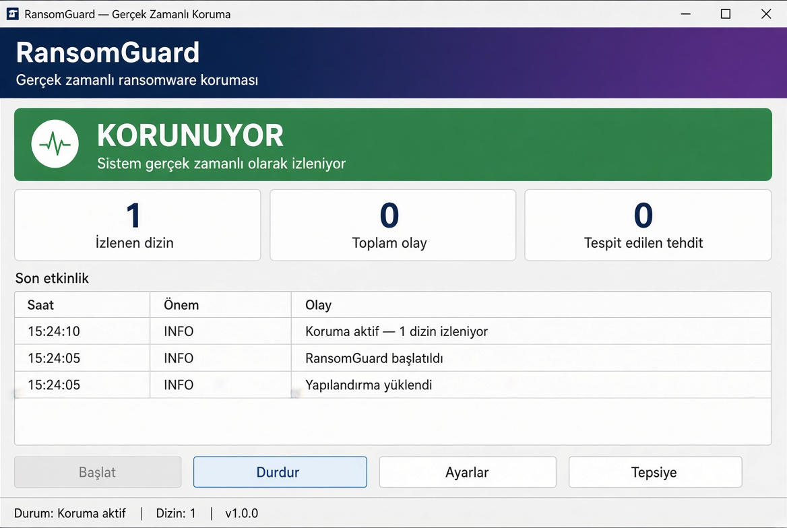

# RansomwareGuard

A lightweight Windows ransomware-behavior detection prototype written in C.

RansomwareGuard monitors a selected directory tree for suspicious file-system activity, including bursts of file modifications and renames to commonly associated extensions. It logs events and raises an alert when configured heuristics are triggered.

> **Status:** Experimental prototype — not a replacement for antivirus/EDR, backups, or a production endpoint protection system.

## Screenshot



## Features

- Real-time recursive directory monitoring using the Windows `ReadDirectoryChangesW` API.
- Heuristic alerts for bursts of file renames and modifications.
- Checks renamed files for a configurable list of suspicious extensions.
- Writes events to the console and `ransomguard.log`.
- Simple response hook (`ResponseAction`) intended for future, carefully tested integrations.

## How detection works

The current implementation uses these heuristics:

- **Rename burst:** 15 or more rename events within a 5-second window.
- **Write burst:** 40 or more modification events within a 5-second window.
- **Suspicious extension:** a renamed file ends in an extension from the built-in list, such as `.locked`, `.encrypted`, `.crypt`, or `.enc`.
- **Notification buffer overflow:** a zero-byte notification result is treated as a high-change-rate warning.

These are simple indicators, not proof of ransomware. Legitimate applications that modify many files can trigger false positives, and ransomware may evade these rules.

## Requirements

- Windows
- A C compiler with Windows API support:
  - MinGW-w64, or
  - Microsoft Visual C++ (MSVC)

## Build

### MinGW-w64

From the project directory:

```bash
x86_64-w64-mingw32-gcc -O2 -Wall -o ransomguard.exe guard.c
```

Run this command in a MinGW-w64 environment. If compiling directly on Windows, use the corresponding MinGW terminal/toolchain.

### MSVC

From a Developer Command Prompt:

```bat
cl /O2 /W4 guard.c /link /out:ransomguard.exe
```

## Usage

Pass the directory you want to monitor:

```bat
ransomguard.exe "C:\Users\YourName\Documents"
```

If no path is supplied, the program attempts to monitor the current user's profile directory.

Run it only on systems and directories you are authorized to monitor. Test first with a disposable directory containing non-important files.

## Logs

The program writes messages to the console and appends them to `ransomguard.log` in its working directory.

## Current limitations

- **Detection only:** the current `ResponseAction()` logs an alert and plays a beep. It does not stop processes, quarantine files, restore encrypted data, or prevent encryption.
- **No process attribution:** directory notifications do not identify which process caused a change.
- **Heuristic-based:** thresholds and extensions can cause false positives or miss other ransomware behavior.
- **Prototype-level event handling:** this is not a hardened security product and should not be relied on as the only layer of protection.
- **Testing required:** validate behavior in a disposable test directory before using it for any real monitoring.

## Roadmap

- [ ] Add configuration for thresholds and suspicious extensions.
- [ ] Improve event aggregation and alert deduplication.
- [ ] Add tests using safe, simulated file activity.
- [ ] Explore reliable process attribution and optional response actions.
- [ ] Add a settings UI and structured log export.

## Contributing

Issues and pull requests are welcome. Please include reproduction steps and test changes in an isolated environment.

## License

No license has been specified yet. Until a license is added, assume that standard copyright restrictions apply.
